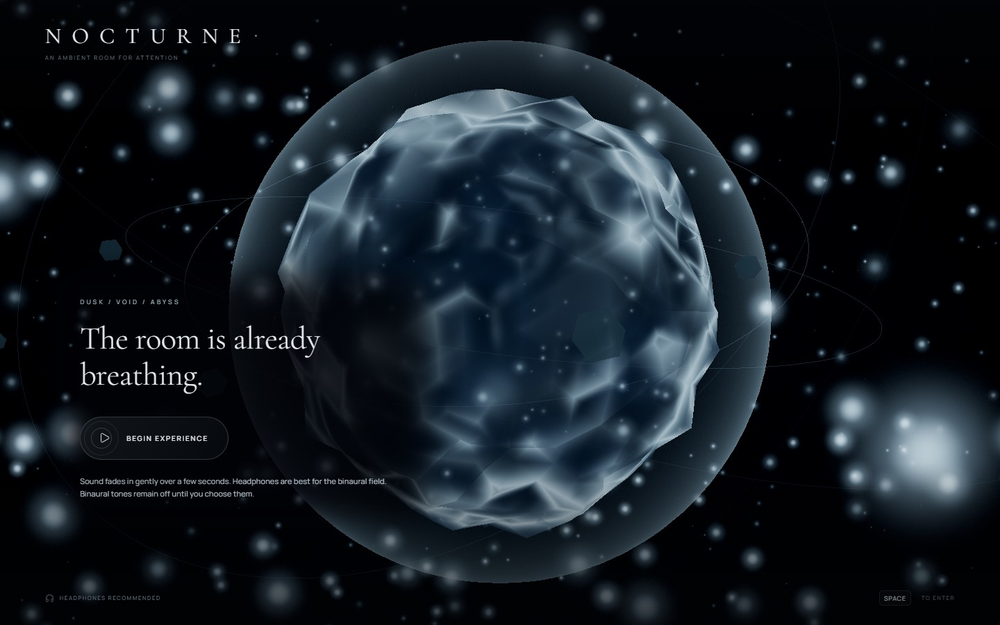
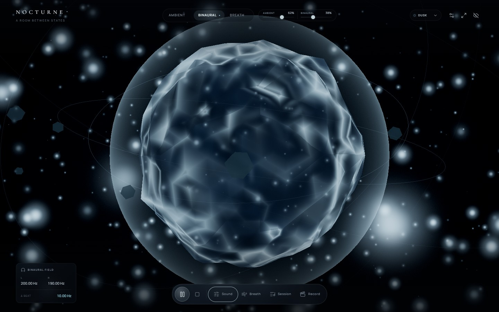
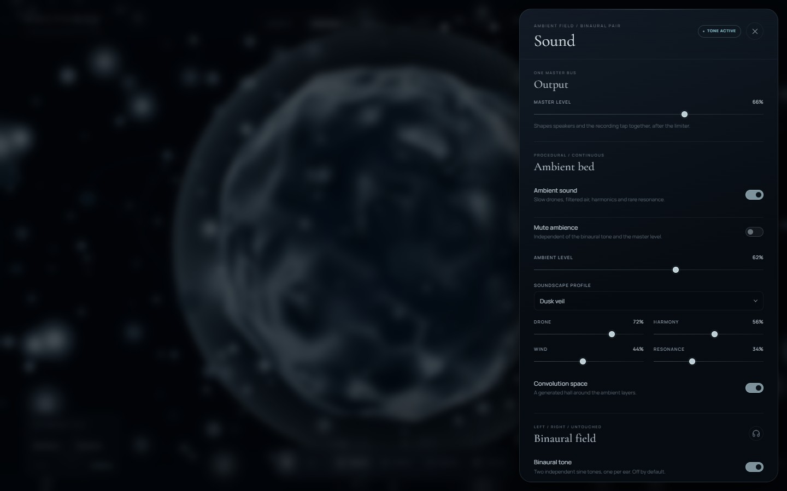
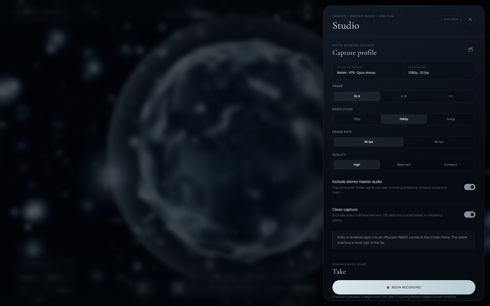
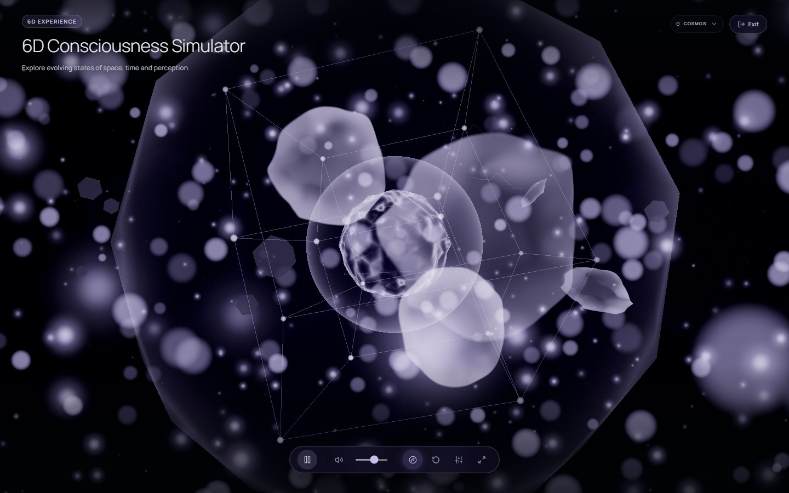
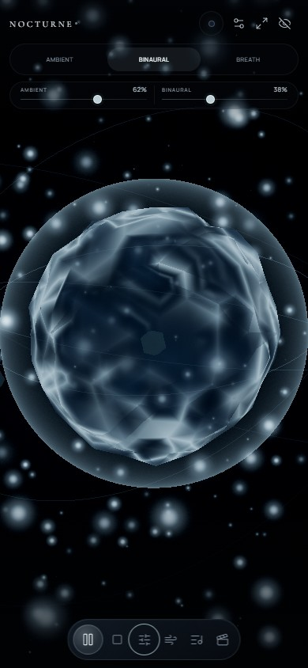

# NOCTURNE

**A room between states.** NOCTURNE is a browser-based ambient environment that combines a generative visual room, an independent binaural tone field, a breathing guide, editable sessions and native WebM recording.

There is no account, no backend and no analytics. Audio, visuals and recordings stay in the current tab until you download them.



## What is inside

### Two independent sound sources

The top bar keeps the **Ambient** and **Binaural** levels visible and separate at all times. Each slider writes to its own audio bus:

- Moving one level never changes the other.
- Changing a level does not enable its source or unmute anything.
- The two sources can play together without their gain controls being merged.
- The same values are still available in the Sound panel, but the quick controls never require opening a panel.

The binaural field uses one hard-panned sine tone per ear: the left channel plays the carrier, and the right channel plays `carrier - beat`. Carrier and beat are adjustable from 100–500 Hz and 0.5–40 Hz. The field is off by default and is intended for headphones.

The ambient bed is generated per atmosphere from slow drones, filtered air, harmonics and resonance, with an optional convolution space. It is mixed independently from the binaural branch.

### Recorded ambience

The ambience library starts every track as a **procedural bed**, so a sound never opens in silence. Some tracks also have a **recorded field recording** attached. When the file has been downloaded and decoded, it crossfades over the procedural bed over 2.2 seconds; when the file is missing or cannot be decoded, the procedural bed simply keeps playing.

Every recording is redistributed under a licence that allows it to ship inside the application (CC0 or public domain). The full list with authors, licences and source links is in [`THIRD_PARTY_NOTICES.md`](THIRD_PARTY_NOTICES.md), per-track licence notes live in `public/licenses/ambient/`, and the same credits are listed in the app under **Settings → Audio credits**.

#### Updating the recorded tracks

The recordings are reproducible from source. `scripts/sources/ambience-sources.json` lists the curated Commons files, the trim window and the processing settings.

```bash
npm run samples:fetch     # download the originals into assets/ambient-raw/ and write the licence lock file
npm run samples:prepare   # trim, loop, normalise and encode into public/audio/ambient/
```

`samples:prepare` needs `ffmpeg`. It uses the `ffmpeg-static` package when it is installed, and falls back to a system `ffmpeg` or the `FFMPEG_BIN` environment variable.

Processing per track:

1. **Trim** to the selected region of the source file.
2. **Seamless loop**: the tail is folded back into the head with an equal-power crossfade, so the loop point is inaudible.
3. **Loudness**: the integrated loudness is measured and a static gain is applied, then a limiter caps the peak. The dynamics of the recording stay intact.
4. **Encode**: Ogg Vorbis for the browser and an MP3 fallback for engines without Ogg support.

The script then regenerates `src/config/ambienceSamples.generated.ts`, the licence notices and the credit table.

### Generative visuals

Five atmospheres are included: **Dusk**, **Void**, **Abyss**, **Ether** and **Cosmos**.

The first four render a procedural WebGL orb with drifting particles, rings, shards, palette shifts and GPU-adaptive quality. **Cosmos** opens the **6D Consciousness Simulator**, a dedicated visual mode with camera drift, manual orientation reset, visual intensity, reduced motion, ambience control and fullscreen.

### Breathing, sessions and a recording studio

- **Breath:** a configurable inhale / hold / exhale / rest pattern with an on-screen guide and optional audio cues.
- **Sessions:** design a sequence of passages, each with its own theme, ambience profile, carrier, beat, binaural and breathing settings, fades and transition time. Sessions can be saved locally, exported as `.nocturne.json`, imported, paused, resumed and stopped.
- **Studio:** record the rendered visual scene together with the post-limiter stereo master as a single WebM file. Capture supports 16:9, 9:16 and 1:1 output, 720p/1080p/1440p, 30/60 fps, pause/resume where the browser supports it, local preview, download and discard.

### Microphone visuals are opt-in

The microphone is used only as an analyser input for the visual field. It is never routed to the speakers or into a recording. It starts only after an explicit action, displays a live indicator, and releases its media tracks when stopped or when the app is disposed.

## Screenshot tour

### The room

The top bar shows both sound levels independently while the binaural field and ambience are active.



### Sound panel

Full control over the master bus, ambient layers, binaural carrier/beat and microphone permissions.



### Studio

Choose frame, resolution, frame rate and quality before recording; the detected codec and destination are shown before the take starts.



### 6D Consciousness Simulator

The Cosmos atmosphere swaps the standard UI for a minimal simulator overlay.



### Mobile layout

The same independent Ambient and Binaural levels remain visible on a phone-sized viewport.

<p align="center">
  
</p>

## Quick start

Requirements: **Node.js `^20.19.0 || >=22.12.0`** and a modern browser with WebGL and Web Audio.

```bash
cd meditasyon
npm install
npm run dev
```

Open the printed local URL (Vite defaults to `http://localhost:5173`), press **Space** or click **Begin experience**, then start with the play button in the bottom dock.

### Scripts

| Command | Purpose |
| --- | --- |
| `npm run dev` | Start the Vite development server. |
| `npm run build` | Type-check and build to `dist/`. |
| `npm run preview` | Preview a production build locally. |
| `npm run typecheck` | Run TypeScript in no-emit mode. |
| `npm test` | Run the Vitest suite. |

### Browser notes

- **Chrome or Edge** is recommended for the Studio panel and VP9/Opus recording.
- Recording uses the browser's native `MediaRecorder` and `HTMLCanvasElement.captureStream`. The app reports unsupported environments instead of silently producing an empty file.
- Audio can only start after a user gesture, as required by browser autoplay policies.
- On iOS and some mobile browsers, WebGL quality, fullscreen, capture and background audio may be limited by the platform.

## Controls

| Input | Action |
| --- | --- |
| `Space` | Begin the experience, or play/pause the room or active session. |
| `F` | Enter/leave fullscreen. The shortcut can be changed in Settings. |
| `H` | Hide or restore the interface. |
| `Escape` | Close a panel, leave fullscreen, then restore a hidden interface. |
| Bottom dock | Play/pause, stop, and open Sound, Breath, Session and Record panels. |
| Top mixer | Adjust Ambient and Binaural levels independently. |

## Audio graph

```text
AmbientSoundEngine ─┐
                    ├─> mix bus ─> session fade ─> transport fade ─> master ─> limiter ─> speakers
BinauralAudioEngine ┘                                                        │
                                                                              ├─> analyser / visuals
                                                                              └─> stereo MediaStreamDestination
                                                                                    (recording tap)
```

The recording tap is taken **after** the limiter, so the exported stereo track matches what is heard. Ambient and binaural gains are applied on separate branches before the shared mix bus.

## Recording pipeline

1. The visual stage is rendered into an offscreen WebGL canvas at the selected aspect, resolution and frame rate.
2. The canvas track is combined with the stereo master audio track from `MediaStreamAudioDestinationNode`.
3. The browser chooses the best supported native codec: `video/webm;codecs=vp9,opus`, then VP8/Opus, then video-only fallbacks.
4. `RecordingEngine` warms up the encoder once per `mimeType|width×height|fps` profile so the first frames are not lost while the platform encoder initializes.
5. On stop, the streaming WebM is given an explicit EBML `Duration` value with the project's own duration patcher. No remuxing or third-party duration fixer is used.
6. The result is exposed as an object URL for preview and download; it is revoked on discard or disposal.

The recorder handles unsupported codecs, empty takes, encoder errors, visibility changes, BFCache/pagehide interruptions and suspended audio without discarding the rest of the application state. Pausing excludes the paused span from the reported duration.

## Project layout

| Path | Responsibility |
| --- | --- |
| `src/audio/` | Web Audio graph, ambient synthesis, binaural oscillators, microphone analyser, audio utilities. |
| `src/config/` | Theme palettes, atmosphere tuning, audio presets, starter session and ambience definitions. |
| `src/recording/` | `RecordingEngine`, codec selection, capture lifecycle and WebM duration stamping. |
| `src/runtime/` | React runtime provider that wires audio, visuals, sessions, recording and global effects together. |
| `src/session/` | Session playback, fades/transitions, envelope helpers and `.nocturne.json` import/export. |
| `src/store/` | Zustand store with persisted preferences, saved sessions and transient playback state. |
| `src/three/` | Procedural WebGL environment, shaders, adaptive quality and Cosmos layer. |
| `src/ui/` | Top bar, panels, session designer, recording HUD, simulator overlay and shared controls. |
| `src/styles/` | Design tokens and responsive layout for desktop and mobile. |
| `public/audio/ambient/` | The processed ambience recordings, in Ogg Vorbis and MP3. |
| `public/licenses/ambient/` | Per-track licence notes for those recordings. |
| `scripts/` | The sample import pipeline: download, licence lock file, processing. |

## Privacy and persistence

- Preferences and saved sessions use browser `localStorage` under the key `nocturne-preferences-v1`.
- Binaural playback is intentionally not restored as active on reload; the volume preference is kept, but the tone must be selected again.
- No microphone signal is written to a recording or sent anywhere. Recordings contain only the canvas and the application's master audio.
- There are no remote services, API keys or analytics requests in the application.
- The recorded ambience files ship with the application. They are fetched from the same origin as the app itself, only when a track is used for the first time.

## Known limits

- Production builds precache the app shell and optional interface modules after the offline worker finishes installing. Recorded ambience becomes available offline after it has been played online. New releases activate after existing app tabs close.
- Audio-only WAV export converts the browser's compressed recording to 16-bit PCM; it is not a lossless capture of the original signal.

- Binaural separation requires headphones. Stereo speakers blend the channels and remove the intended difference.
- Native output is WebM (VP9/VP8 + Opus where available). MP4 requires a separate conversion.
- 60 fps capture depends on the GPU, display and browser encoder; 30 fps is the safer default.
- Mobile browsers and battery-saver modes may suspend WebGL, audio or capture when the tab is hidden.
- A recorded ambience file is downloaded the first time its track is used. Until it arrives, the procedural version of that track plays.
- NOCTURNE is an atmosphere and attention space, not a medical device or treatment.

## License

ISC. See [`package.json`](package.json) for package metadata.
